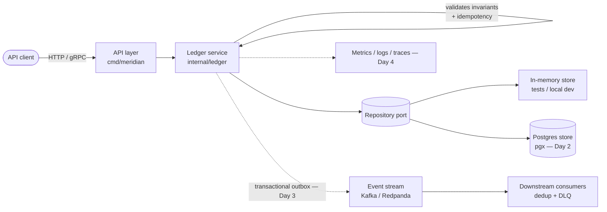

# Meridian Ledger

A production-grade, idempotent **double-entry payments ledger** service in Go.

Meridian Ledger is the bookkeeping core you would put underneath a payments
platform: every movement of money is recorded as a balanced set of debits and
credits in an append-only journal, balances are always derived from that
journal, and every posting is safe to retry. It is built to demonstrate the
properties a real ledger must have — correctness first, then throughput —
rather than to be a CRUD demo.

> Status: under active development. See [ROADMAP.md](ROADMAP.md) for the
> build plan and what has landed so far.

## Why this exists

Payment systems fail in boring, expensive ways: a retried request charges a
customer twice, a partial write leaves the books unbalanced, a float rounds
a balance into fiction. Meridian Ledger is designed around eliminating those
failure classes:

- **Correctness** — the balanced-books invariant (total debits == total
  credits) is enforced in the domain layer on every posting. An unbalanced
  transaction cannot be persisted, by construction.
- **Idempotency** — every posting carries a caller-supplied idempotency key.
  Retries return the original transaction instead of double-applying, and
  re-using a key with a different payload is rejected as a conflict.
- **Auditability** — the journal is append-only and immutable. Balances are
  derived, never stored as a mutable number that can drift from history.
  Corrections happen through reversing entries, exactly as in real
  bookkeeping.
- **No float money** — all amounts are integer minor units (cents, sen,
  fils). There is not a single float in the money path.

## Architecture



The domain package (`internal/ledger`) has no dependency on any storage or
transport technology. Storage sits behind a small `Repository` interface, so
the in-memory store used in tests and the Postgres store used in production
exercise exactly the same invariant and idempotency logic.

## Layout

```
cmd/meridian/        Service entry point (HTTP server, health endpoints)
internal/ledger/     Double-entry domain: accounts, entries, transactions,
                     invariant + idempotency enforcement, balance derivation
internal/store/      Store interface, in-memory implementation, Postgres stub
```

## Key design decisions

1. **Integer minor units everywhere.** Amounts are `int64` counts of the
   currency's smallest unit. This removes an entire class of rounding bugs
   and makes equality checks — the heart of the balanced invariant — exact.
2. **Balances are derived, not stored.** A balance is a fold over the
   account's journal entries. It can never disagree with history, and any
   point-in-time balance can be reconstructed by folding a prefix of the
   journal.
3. **Idempotency is a domain concern, not a transport concern.** Keys are
   checked inside the posting operation (and, in Postgres, backed by a
   unique constraint), so HTTP retries, gRPC retries and queue redeliveries
   are all safe.
4. **One currency per transaction.** Cross-currency movement is modelled as
   two balanced transactions joined by an explicit FX step, never as a
   single transaction that silently mixes currencies.
5. **Append-only journal.** Stored entries are deep-copied on write and
   never mutated. Reversals are new transactions, preserving a complete
   audit trail.
6. **Standard library first.** The Day 1 core has zero external
   dependencies. Infrastructure dependencies (pgx, Kafka client) are added
   only where they earn their place, behind interfaces.

## Running it

Requires Go 1.24+ (developed against the latest stable Go).

```sh
go build ./...
go test ./...

# Start the service (in-memory store, health endpoints on :8080)
go run ./cmd/meridian

curl localhost:8080/healthz
# {"service":"meridian-ledger","status":"ok"}
```

Configuration: `PORT` sets the listen port (default `8080`).

## Roadmap summary

- **Day 1** — Scaffold, double-entry core with invariant + idempotency
  enforcement, in-memory store, unit tests, CI. ✅
- **Day 2** — HTTP + gRPC APIs, Postgres store (pgx), optimistic
  concurrency, integration tests.
- **Day 3** — Transactional outbox → Kafka/Redpanda streaming, consumers
  with deduplication and dead-letter handling.
- **Day 4** — Observability (Prometheus metrics, structured logs, tracing
  hooks), rate limiting, graceful shutdown, load-test harness with published
  benchmark numbers.
- **Day 5** — Docker + Kubernetes manifests, docker-compose full stack,
  failure-injection tests, results polish.

Full detail in [ROADMAP.md](ROADMAP.md).

## License

MIT — see [LICENSE](LICENSE).
