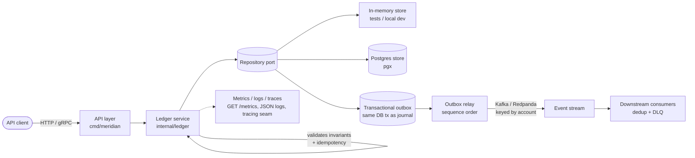

# Meridian Ledger

A production-grade, idempotent **double-entry payments ledger** service in Go.

Meridian Ledger is the bookkeeping core you would put underneath a payments
platform: every movement of money is recorded as a balanced set of debits and
credits in an append-only journal, balances are always derived from that
journal, and every posting is safe to retry. It is built to demonstrate the
properties a real ledger must have — correctness first, then throughput —
rather than to be a CRUD demo.

> Status: the five-day build is complete. See [ROADMAP.md](ROADMAP.md)
> for the build plan and what landed each day.

## Why this exists

Payment systems fail in boring, expensive ways: a retried request charges a
customer twice, a partial write leaves the books unbalanced, a float rounds
a balance into fiction. Meridian Ledger is designed around eliminating those
failure classes:

- **Correctness** — the balanced-books invariant (total debits == total
  credits) is enforced in the domain layer on every posting. An unbalanced
  transaction cannot be persisted, by construction.
- **Idempotency** — every posting carries a caller-supplied idempotency key.
  Retries return the original transaction instead of double-applying, and
  re-using a key with a different payload is rejected as a conflict.
- **Auditability** — the journal is append-only and immutable. Balances are
  derived, never stored as a mutable number that can drift from history.
  Corrections happen through reversing entries, exactly as in real
  bookkeeping.
- **No float money** — all amounts are integer minor units (cents, sen,
  fils). There is not a single float in the money path.

## Architecture



The domain package (`internal/ledger`) has no dependency on any storage or
transport technology. Storage sits behind a small `Repository` interface, so
the in-memory store used in tests and the Postgres store used in production
exercise exactly the same invariant and idempotency logic.

## Layout

```
cmd/meridian/        Service entry point (HTTP + gRPC servers, health endpoints,
                     /metrics, coordinated shutdown)
cmd/loadtest/        Black-box load-test harness (HTTP postings, latency percentiles)
internal/ledger/     Double-entry domain: accounts, entries, transactions,
                     invariant + idempotency enforcement, balance derivation,
                     versioned balance snapshots
internal/store/      Store interface, in-memory implementation, pgx Postgres
                     implementation (schema in internal/store/schema.sql),
                     transactional outbox in both backends
internal/events/     Event model (one event per account leg), outbox relay
                     to Kafka/Redpanda, reference consumer with dedup + DLQ,
                     failure-injection tests (duplicate delivery, crash/restart)
internal/api/        HTTP JSON API (same contract as the gRPC surface),
                     request-ID / logging / tracing middleware, posting rate limiter
internal/grpcapi/    gRPC adapter over the generated protobuf service,
                     logging / tracing / metrics interceptors
internal/metrics/    Prometheus exposition (dependency-free): posting latency,
                     rejections by reason, outbox lag gauges
internal/tracing/    Tracing seam: Tracer/Span interfaces, no-op default
gen/ledger/v1/       Generated protobuf + gRPC code (from proto/ledger/v1/)
proto/ledger/v1/     Protobuf service definition (source of truth)
Dockerfile           Multi-stage build: Go builder, distroless non-root runtime
docker-compose.yml   Local full stack: service + Postgres + Redpanda
deploy/k8s/          Kubernetes manifests: Deployment, Service, ConfigMap,
                     probes, HPA (see docs/DEPLOYMENT.md for the 1-replica rule)
docs/                EVENTS.md (delivery contract), OPERABILITY.md (metrics,
                     logs, tracing, shutdown), DEPLOYMENT.md (image, compose,
                     Kubernetes, failure modes)
```

## Running the full stack

The fastest way to see the whole system — API, durable Postgres journal,
and real broker events — is docker-compose:

```sh
docker compose up --build
curl localhost:8080/healthz
# {"service":"meridian-ledger","status":"ok"}
```

For Kubernetes, see [`docs/DEPLOYMENT.md`](docs/DEPLOYMENT.md): manifests
in `deploy/k8s/`, a Secret for `DATABASE_URL`, and one rule that matters
— keep replicas at 1 while the outbox relay runs in-process, because the
relay is single-instance by design.

## End-to-end walkthrough

With the full stack up (or with `go run ./cmd/meridian` for the
in-memory variant), the whole loop — accounts, a balanced posting, a
derived balance, and the event stream — looks like this:

```sh
# 1. Create the two sides of a sale.
curl -X POST localhost:8080/api/accounts \
  -d '{"id":"cash","name":"Cash","currency":"USD"}'
curl -X POST localhost:8080/api/accounts \
  -d '{"id":"revenue","name":"Revenue","currency":"USD"}'

# 2. Post a $50.00 card sale. Retry this exact request as often as you
#    like: the idempotency key makes every retry return the original
#    transaction instead of double-applying it.
curl -X POST localhost:8080/api/transactions \
  -d '{"idempotency_key":"sale-1","memo":"card sale","entries":[
        {"account_id":"cash","direction":"debit","amount_minor":5000},
        {"account_id":"revenue","direction":"credit","amount_minor":5000}]}'

# 3. Read the derived balance (cash is a debit-balance account, so it
#    reads positive; revenue reads negative, a net credit balance).
curl localhost:8080/api/accounts/cash/balance
# {"account_id":"cash","balance_minor":5000,"currency":"USD","version":1}
curl localhost:8080/api/accounts/revenue/balance
# {"account_id":"revenue","balance_minor":-5000,"currency":"USD","version":1}

# 4. Confirm the posting was rejected-proof: an unbalanced twin is refused.
curl -X POST localhost:8080/api/transactions \
  -d '{"idempotency_key":"bad-1","entries":[
        {"account_id":"cash","direction":"debit","amount_minor":5000},
        {"account_id":"revenue","direction":"credit","amount_minor":4999}]}'
# {"error":"...","code":"validation"} (HTTP 400)

# 5. Watch the pipeline drain: the outbox backlog gauge falls to zero as
#    the relay publishes, and the posting counters record the outcomes.
curl localhost:8080/metrics | grep -E 'meridian_(postings_total|outbox_pending)'
```

With docker-compose, step 5's events are also on the broker — one
`ledger.transaction.posted.v1` event per account leg, keyed by account,
so each account's events stay ordered. The delivery contract (at-least-once,
consumer deduplication, dead letters) is documented in
[`docs/EVENTS.md`](docs/EVENTS.md), and the failure modes it survives —
database death mid-posting, duplicate deliveries, consumer and relay
crash/restart — are covered by the failure-injection tests in
`internal/ledger/failure_test.go` and `internal/events/failure_test.go`.

## Key design decisions

1. **Integer minor units everywhere.** Amounts are `int64` counts of the
   currency's smallest unit. This removes an entire class of rounding bugs
   and makes equality checks — the heart of the balanced invariant — exact.
2. **Balances are derived, not stored.** A balance is a fold over the
   account's journal entries. It can never disagree with history, and any
   point-in-time balance can be reconstructed by folding a prefix of the
   journal.
3. **Idempotency is a domain concern, not a transport concern.** Keys are
   checked inside the posting operation (and, in Postgres, backed by a
   unique constraint), so HTTP retries, gRPC retries and queue redeliveries
   are all safe.
4. **One currency per transaction.** Cross-currency movement is modelled as
   two balanced transactions joined by an explicit FX step, never as a
   single transaction that silently mixes currencies.
5. **Append-only journal.** Stored entries are deep-copied on write and
   never mutated. Reversals are new transactions, preserving a complete
   audit trail.
6. **Standard library first.** The Day 1 core has zero external
   dependencies. Infrastructure dependencies (pgx, Kafka client) are added
   only where they earn their place, behind interfaces.

## Running it

Requires Go 1.24+ (developed against the latest stable Go).

```sh
go build ./...
go test ./...

# Start the service (in-memory store; HTTP on :8080, gRPC on :9090)
go run ./cmd/meridian

curl localhost:8080/healthz
# {"service":"meridian-ledger","status":"ok"}
```

Configuration: `PORT` sets the HTTP listen port (default `8080`),
`GRPC_PORT` the gRPC port (default `9090`), and `DATABASE_URL` selects
the Postgres store (a Postgres connection string). When `DATABASE_URL`
is unset, the in-memory store is used. `KAFKA_BROKERS` (comma-separated)
starts the outbox relay publishing to `KAFKA_TOPIC` (default
`meridian-ledger-events`); without it, events accumulate unpublished in
the outbox and a later brokered run publishes them in order. See
[`docs/EVENTS.md`](docs/EVENTS.md) for the delivery contract: at-least-once
delivery with consumer deduplication, per-account ordering, and
dead-letter handling. `POST_RATE_LIMIT_RPS` (default `100`) and
`POST_RATE_LIMIT_BURST` (default `200`) configure per-IP rate limiting
on the posting API (`0` disables it). `GET /metrics` serves Prometheus
metrics. Full operability detail — series, log fields, tracing seam,
shutdown order — is in [`docs/OPERABILITY.md`](docs/OPERABILITY.md).

### Event streaming

Every posting is fanned out into one `ledger.transaction.posted.v1`
event per account it touches, keyed by that account so each account's
events stay ordered on the broker. The outbox rows commit in the same
database transaction as the journal write, so an event can never exist
without its transaction. Downstream, the reference consumer in
`internal/events` deduplicates on the deterministic event ID, retries a
failing handler (default 3 attempts), then dead-letters the event instead
of looping on it.

### API

HTTP (JSON, under `/api`):

```sh
curl -X POST localhost:8080/api/accounts \
  -d '{"id":"cash","name":"Cash","currency":"USD"}'
curl -X POST localhost:8080/api/transactions \
  -d '{"idempotency_key":"sale-1","memo":"card sale","entries":[
        {"account_id":"cash","direction":"debit","amount_minor":5000},
        {"account_id":"revenue","direction":"credit","amount_minor":5000}]}'
curl localhost:8080/api/accounts/cash/balance
# {"account_id":"cash","balance_minor":5000,"currency":"USD","version":1}
```

The balance response carries a `version` that increments on every posting
touching the account: a snapshot read at version V is stale as soon as the
version moves, which is the optimistic-concurrency signal for readers.

The gRPC surface mirrors the HTTP API exactly; see
[`proto/ledger/v1/ledger.proto`](proto/ledger/v1/ledger.proto). Regenerate
the Go bindings after editing the proto file with:

```sh
protoc -I proto \
  --go_out=gen --go_opt=paths=source_relative \
  --go-grpc_out=gen --go-grpc_opt=paths=source_relative \
  proto/ledger/v1/ledger.proto
```

### Benchmarks

Measured 2026-11-04 on the dev VM (AMD EPYC, in-memory store, single
instance, localhost client). These are a throughput ceiling for the
in-memory path, not a capacity promise — Postgres numbers will be
lower, and production capacity needs a test against the real topology.

**HTTP load test** (`cmd/loadtest`, 16 workers, 10s, rate limiting
disabled, every posting a unique idempotency key):

```
loadtest: 65902 requests in 10.05s (6556.6 req/s)
  created: 65902  rate-limited: 0  errors: 0
  latency: p50=1.48ms p95=5.01ms p99=31.52ms max=89.48ms
```

The p99 tail is scheduling and GC under contention, not the posting
path itself: the in-domain benchmark below posts in under 4µs. The
service serializes postings on one mutex (the idempotency
check-and-insert), so throughput here is effectively single-core
posting throughput plus HTTP overhead — sharding that lock is the
obvious next scaling step if throughput ever becomes the constraint.

**In-domain benchmarks** (`go test -bench=. ./internal/ledger/`,
journal of 1,000 postings for the snapshot benchmark):

```
BenchmarkPost-4               379604    3771 ns/op
BenchmarkBalanceSnapshot-4    143743    8362 ns/op
```

With default rate limiting on (100 req/s, burst 200 per IP), the same
16-worker load test from one machine — one shared IP bucket — yielded
700 created and 34,702 rate-limited requests with 0 errors, which is
the limiter doing exactly what it is for.

### Integration tests

The Postgres integration test runs against a real database and is skipped
unless `MERIDIAN_TEST_DATABASE_URL` points at a scratch database (the
test truncates the ledger tables, so never point it at real data):

```sh
MERIDIAN_TEST_DATABASE_URL=postgres://postgres@localhost:5432/meridian_test \
  go test ./internal/store/ -run TestPostgresStoreIntegration -v
```

## Roadmap summary

- **Day 1** — Scaffold, double-entry core with invariant + idempotency
  enforcement, in-memory store, unit tests, CI. ✅
- **Day 2** — HTTP + gRPC APIs, Postgres store (pgx), optimistic
  concurrency, integration tests. ✅
- **Day 3** — Transactional outbox → Kafka/Redpanda streaming, consumers
  with deduplication and dead-letter handling. ✅
- **Day 4** — Observability (Prometheus metrics, structured logs, tracing
  hooks), rate limiting, graceful shutdown, load-test harness with published
  benchmark numbers. ✅
- **Day 5** — Docker + Kubernetes manifests, docker-compose full stack,
  failure-injection tests, results polish. ✅

Full detail in [ROADMAP.md](ROADMAP.md).

## License

MIT — see [LICENSE](LICENSE).
